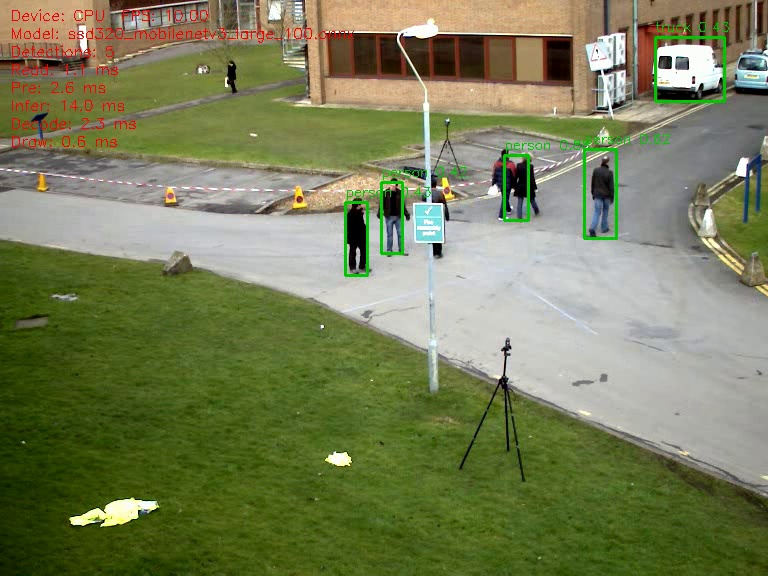
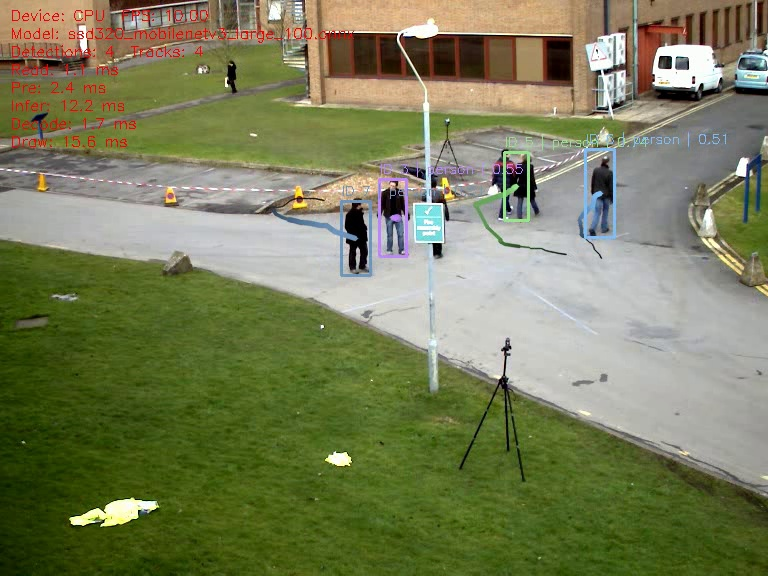

# Linux 课程实验记录

机械工程本科生的 Linux 入门课程实践，实验于2026年10月16日至17日在 Windows 11 和 WSL Ubuntu 上完成。代码由课程资料及 AI 辅助指导提供，学生实际执行、截图、核对结果并给出个人观察。

## 阅读入口

- [课程报告](REPORT.md)
- [复现说明](REPRODUCE.md)
- [原始截图与检测跟踪图片](evidence/)
- [原始运行日志](logs/)
- [Python 统计结果](results/fusion_summary.txt)
- [代码和数据来源](SOURCES.md)

## 已完成实验

| 实验 | 实际结果 | 验证方法 |
|---|---|---|
| 文件与执行权限 | 644时直接执行被拒绝，增加所有者执行权限后成功 | 权限与终端截图 |
| Python JSON统计 | graph_fusion共37项，effect_times大于0的有8项 | 输出文本、原始字段抽查 |
| CPU视频检测 | 阈值0.35的输出可读取795帧 | 逐帧解码、检测结果图 |
| 阈值比较 | 0.20补充远处行人，同时出现重复框与大范围错误框 | 同一第100帧比较 |
| 人物跟踪 | 生成编号和轨迹，输出可读取795帧 | 运行日志、第100和110帧、逐帧检查 |

本仓库记录的是普通电脑CPU运行路径，不是昇腾开发板项目复现。阈值0.20的输出已运行结束并提取第100帧，但未单独记录其完整帧数验证。没有训练模型、没有开展全视频精度评测或机器人路径规划实验。

## 结果预览

阈值0.35：

阈值0.20：

人物跟踪：

视频、模型和虚拟环境不纳入仓库，来源和运行方式见复现说明。截图及日志保留实验时的用户名和本地路径；不包含密码或令牌。

