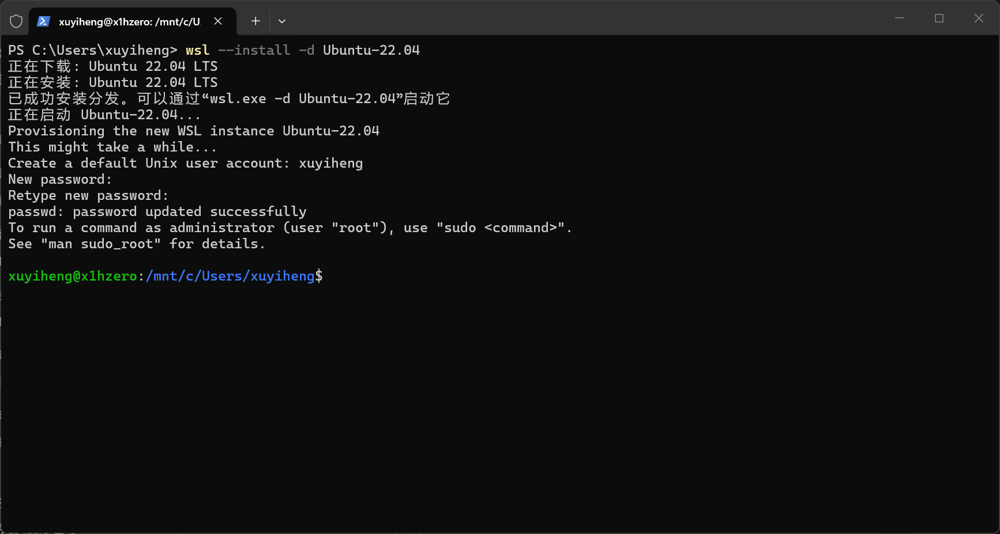
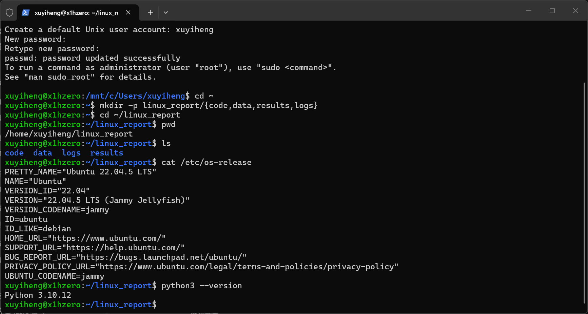
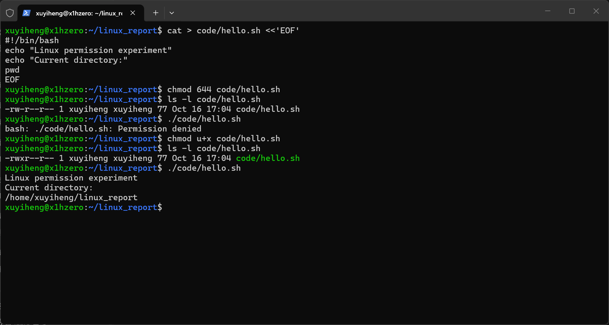
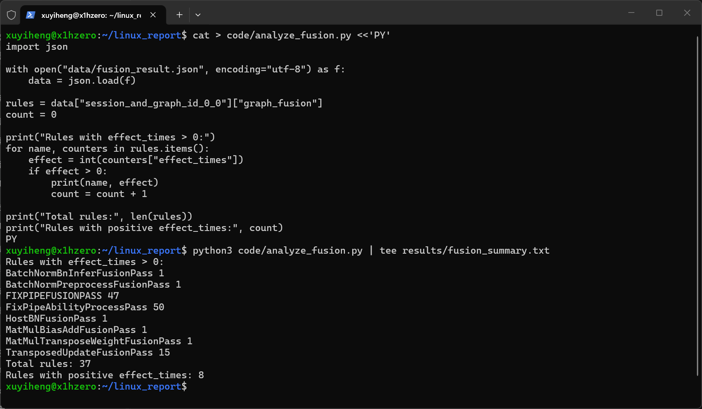
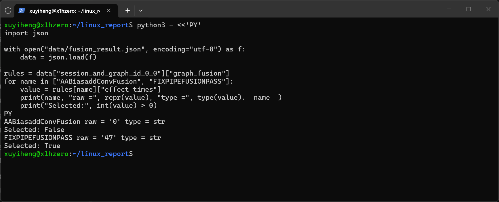
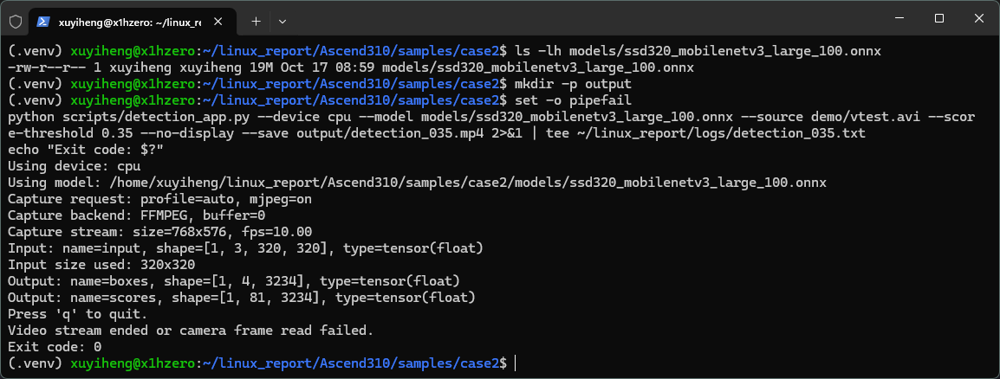
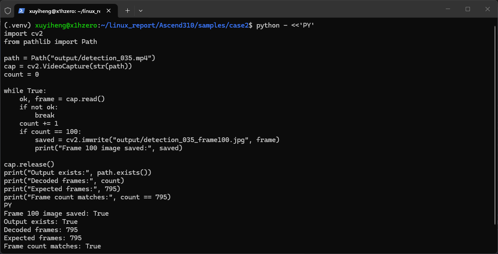
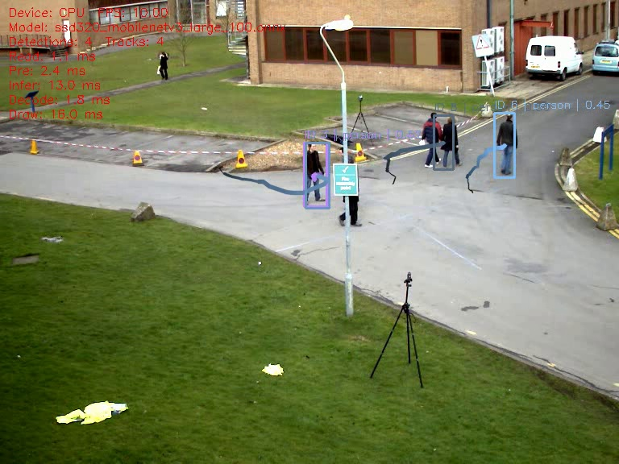

# Linux基础操作与Python视觉应用课程实践报告

## 一 课程学习背景与实践目标

我是一名机械工程专业本科生，编程基础较薄弱。选修Linux入门课程后，我接触了文件管理、终端操作、Python程序运行和SSH远程连接，也曾在课堂中通过局域网连接教师的开发板。

教师课程资料围绕昇腾310B平台组织，包含Ubuntu基础、Python编程、远程开发以及人脸考勤、目标跟踪和智能电子琴等案例。课件展示的实验板为Orange Pi AIpro（8T）。本次无法使用教师开发板，因此在自己的Windows 11电脑上安装WSL和Ubuntu，使用教师案例提供的CPU运行方式完成实践。板卡说明见课程的[硬件基础课件](https://github.com/zhouxzh/Ascend310/blob/2b1c6f509dc9bf12715b65413dd9edebcaffdce2/src/presentation/01-hardware-basics.md)。

本次具体任务是：建立实验目录，对比脚本执行权限修改前后的结果；使用Python读取教师提供的JSON文件并统计符合条件的规则；运行现成的目标检测和跟踪程序，检查输出视频，并比较不同阈值下同一帧的检测结果。

## 二 实验环境搭建与文件管理

### 2.1 环境安装过程

开始实验时，我发现这台电脑并没有安装WSL。在管理员PowerShell中查看状态后，系统提示尚未安装适用于Linux的Windows子系统。我执行 `wsl --install -d Ubuntu-22.04`，完成WSL组件和虚拟机平台的安装，再根据提示重启。重启后检查发现没有已安装的Linux分发，于是继续执行安装命令，安装Ubuntu并创建普通用户。

WSL组件与Ubuntu分发版需要分别完成安装。首次设置Linux密码时，终端不显示输入字符；输入并确认密码后，系统提示密码更新成功。



| 项目 | 本次环境 |
|---|---|
| 主机系统 | Windows 11 |
| 内存 | 16 GB，依据本人电脑配置说明 |
| WSL软件包 | 安装界面显示3.0.3；该版本号与WSL1/WSL2运行模式不同 |
| Linux分发版 | Ubuntu 22.04.5 LTS |
| Python | 3.10.12 |
| 数值与图像依赖 | NumPy 1.26.4、OpenCV 4.11.0.86、SciPy 1.12.0 |
| 模型推理 | ONNX Runtime 1.15.1，CPU模式 |
| 专用开发板 | 本次未使用 |

分发版的WSL1或WSL2运行模式需要通过 `wsl --list --verbose` 查看，本次未记录这一项。

### 2.2 目录组织与独立Python环境

进入Ubuntu后，初始路径位于 `/mnt/c/Users/xuyiheng`，对应Windows的C盘用户目录。我使用 `cd ~` 返回Linux用户主目录，在 `linux_report` 下创建 `code`、`data`、`results` 和 `logs` 四个文件夹，分别保存代码、输入、输出和运行记录。通过 `pwd` 和 `ls` 检查位置和目录结构，再查看系统与Python版本。



统计脚本中的 `data/fusion_result.json` 是相对路径，按运行命令时所在的目录查找文件。因此，运行该脚本时需要注意当前目录。

为了运行视觉案例，我创建并激活 `.venv` 独立Python环境，确认Python和pip路径均指向该环境，然后按照教师的 `requirements.txt` 安装依赖。

## 三 Linux文件执行权限实验

### 3.1 实验目的与操作

本实验检验文件存在、内容可读和文件可直接执行之间的区别。我在AI辅助指导下创建 `code/hello.sh`，内容如下：

```bash
#!/bin/bash
echo "Linux permission experiment"
echo "Current directory:"
pwd
```

第一行指定使用Bash解释脚本，两条 `echo` 命令输出说明文字，`pwd` 显示当前目录。随后执行 `chmod 644 code/hello.sh`，用 `ls -l` 查看权限，再使用 `./code/hello.sh` 直接运行。此时权限为 `-rw-r--r--`，终端返回 `Permission denied`。

接着执行 `chmod u+x code/hello.sh`，权限变为 `-rwxr--r--`。再次运行相同脚本，成功输出：

```text
Linux permission experiment
Current directory:
/home/xuyiheng/linux_report
```



### 3.2 结果与理解

`u` 表示文件所有者，`+x` 表示增加执行权限。644中，所有者具备读写权限，组用户和其他用户只有读取权限，三类用户均没有执行权限。本次只为所有者增加了执行权限，脚本内容没有改变，直接执行的结果由拒绝执行变为成功。

本次测试的是 `./code/hello.sh` 直接执行方式。由Bash解释器读取脚本是另一种调用方式，本实验没有对它进行对照测试。

## 四 Python读取课程数据与统计验证

### 4.1 输入数据与程序设计

我从教师仓库下载 `samples/case1/fusion_result.json`，用Python检查顶层键及其子项。文件包含 `session_and_graph_id_0_0`，其下有 `graph_fusion` 和 `ub_fusion`。本次只统计 `graph_fusion` 中 `effect_times` 大于0的规则数量。

这份JSON是教师提供的输入数据。我的操作是读取、筛选和统计，没有在本机运行模型转换或优化过程。统计脚本在AI辅助指导下编写。

核心代码为：

```python
rules = data["session_and_graph_id_0_0"]["graph_fusion"]
count = 0
for name, counters in rules.items():
    effect = int(counters["effect_times"])
    if effect > 0:
        print(name, effect)
        count = count + 1
```

两层方括号用于逐层访问字典，`items()`在循环中取出名称和对应数据，`int()`把字符串形式的数值转为整数。符合条件时输出规则名称并将计数加1。这里统计的是符合条件的规则条数，不是所有规则的 `effect_times` 数值之和。

### 4.2 实际输出与抽查

程序输出规则总数37，其中8条规则的 `effect_times` 大于0。输出通过 `tee` 同时显示在终端并保存到文本文件。



随后我抽查两个原始字段：`AABiasaddConvFusion` 的值为字符串 '0'，转换为整数并判断是否大于0后，结果为False；`FIXPIPEFUSIONPASS` 的值为字符串 '47'，同样判断后，结果为True。



在解释 `int()` 时，我曾认为不转换就会比较“字符串对应的整数”。字段抽查显示，这两个原始值的类型都是 `str`。AI辅助解释指出：Python 3中字符串与整数直接使用大于号会产生类型错误；两个字符串之间按字符顺序比较，不等同于数值大小。本程序先用 `int()` 转换再与0比较，实际运行记录中没有触发上述类型错误。

## 五 CPU视频目标检测与跟踪

### 5.1 案例来源和处理流程

视觉实验采用教师仓库 `samples/case2` 中的检测和跟踪程序，运行入口分别为 `scripts/detection_app.py` 与 `scripts/tracking_app.py`。我使用现成代码和已训练模型，完成环境配置、输入指定、阈值调整、输出保存和结果观察。

检测程序读取视频帧，将其转换为模型所需输入，执行CPU推理，再对结果进行解码与筛选，绘制目标框并保存视频。跟踪程序在检测结果基础上关联前后帧，维护目标编号和轨迹。

根据本次使用版本的 `tracking/deepsort.py`，教师的跟踪实现使用卡尔曼预测、检测框重叠程度和匹配算法关联目标，属于简化的DeepSORT风格实现，没有完整的外观重识别功能。这是对教师源码的说明，相关算法并非本人编写。[源码依据](https://github.com/zhouxzh/Ascend310/blob/2b1c6f509dc9bf12715b65413dd9edebcaffdce2/samples/case2/tracking/deepsort.py)

模型文件为 `ssd320_mobilenetv3_large_100.onnx`。输入视频来自OpenCV官方测试文件 `vtest.avi`，实际读取结果为768×576、795帧、10帧/秒。日志显示模型输入形状为 `[1,3,320,320]`；原视频尺寸与模型尺寸不同，需要经过预处理。

### 5.2 下载问题与排查

首次通过Python下载测试视频时，在HTTPS连接建立过程中出现 `Connection reset by peer`。报错发生在网络连接阶段，程序尚未执行到OpenCV读取视频的步骤。随后重新执行原下载程序，下载成功，第一帧读取结果为True。

连接被重置的具体原因没有继续排查。

### 5.3 基准检测及输出检查

首次运行显式指定 `--device cpu`，置信度阈值为0.35，并使用 `--no-display` 关闭窗口显示，将结果保存为 `detection_035.mp4`。日志确认使用CPU，终端退出状态为0。



程序末尾提示“视频流结束或摄像头读帧失败”，这条提示同时涵盖正常结束和读帧失败两种情况。我又逐帧读取输出文件，得到795帧，与输入记录一致，并保存第100帧观察检测效果。




第100帧中，左上方远处的行人没有检测框，路灯遮挡附近的人员存在漏检，两名并排行人未被分别完整检出。画面共显示5个检测结果，其中包含右上方的车辆。

### 5.4 置信度阈值对比

保持视频、模型和其余参数不变，我把置信度阈值由0.35降为0.20，再提取同一第100帧。较低阈值会保留更多低分候选结果。


| 观察对象 | 阈值0.35 | 阈值0.20 |
|---|---|---|
| 远处行人 | 无检测框 | 出现两个框，存在重复检测 |
| 路灯遮挡附近人员 | 存在漏检 | 仍存在漏检 |
| 并排行人 | 未分别完整检出 | 未分别完整检出 |
| 大范围背景框 | 未出现 | 出现明显不合理的大框 |

在所比较的第100帧中，降低阈值后远处行人出现了检测框，同时出现重复框和大范围背景框。路灯附近和并排行人的问题仍然存在。这个对比说明，降低阈值在该帧中补充了检测结果，也引入了错误结果；它不足以判断整段视频中哪个阈值更合适。

我推测，远处人物缩放后细节减少、遮挡后可见特征不足，可能影响检测。并排行人的身体重叠以及程序对候选框的筛选，也可能影响最终结果。本次没有检查全部候选框，尚未确定这些现象的具体原因。

### 5.5 人物跟踪与局限

随后我使用0.35阈值运行跟踪入口，并设置 `--track-classes person`，只跟踪人物。程序正常退出，输出 `tracking_035.mp4` 经逐帧检查同样可读取795帧。我提取第100和110帧，两者按输入视频帧率相隔约1秒。




两幅图中出现了目标编号和轨迹线，但远处人员和遮挡附近仍有漏检，并排行人也未被分别完整检出。在这两帧中，两名并排行人的位置接近；是否因此影响检测和关联，还需要进一步检查。

部分编号标签重叠，仅凭这两幅图无法判断整段视频中同一人物的编号是否稳定。这里的编号用于关联前后帧中的目标，不表示人物真实身份。

截图显示10 FPS，与输入视频帧率一致。本次没有单独测试处理速度，不将这个数值作为CPU性能结论。

## 六 课程应用理解与专业思考

课程还介绍了人脸考勤和智能电子琴，本次实际运行的是目标检测与跟踪的CPU程序。

我曾把检测理解为截取关键帧识别，把跟踪理解为持续识别。本案例的检测程序本身也逐帧处理视频，跟踪则进一步关联前后帧中的目标。是否持续运行检测程序，与是否维护同一目标的编号和轨迹，是两个不同的问题。

结合机械工程，我最关注遮挡造成的人员漏检。在本次展示的画面中，路灯附近可见人员，但没有相应的完整检测框。如果将类似视觉程序用于移动设备，人员与机器在画面中重叠时的漏检，可能影响设备对障碍物的判断和路径规划。这是根据实验现象提出的应用设想，本次没有连接真实设备，也没有运行路径规划程序。

## 七 学习总结与成果索引

本次在Windows 11电脑上搭建了WSL Ubuntu环境，完成文件权限对比、JSON数据统计，以及教师检测和跟踪程序的CPU运行。实验文件包括练习脚本、输入数据、运行日志、统计输出和结果截图。

目前我对复杂跟踪算法仍主要停留在流程理解，尚不能独立实现卡尔曼滤波或神经网络。后续计划先学习函数和模块组织，再尝试导出轨迹坐标，条件允许时回到开发板比较CPU与NPU运行环境的差异。

这些操作是在教师资料和AI指导下完成的。检测、跟踪程序及已训练模型来自教师案例及其提供的模型来源；`code/hello.sh`、`code/analyze_fusion.py` 等练习脚本，以及下载、检查帧数和提取图片所用的辅助代码，有AI参与提供或编写。本人在电脑上执行命令和程序、保存截图，并提出对漏检、重复框和遮挡问题的观察。AI还辅助解释命令和代码、整理课程资料及修改报告文字。

成果仓库：[trueyh/linux-course-practice](https://github.com/trueyh/linux-course-practice)；在线报告：[REPORT.md](https://github.com/trueyh/linux-course-practice/blob/main/REPORT.md)。本地对应文件为 [README](README.md)、[复现说明](REPRODUCE.md)、[结果图片与截图](evidence/)、[原始日志](logs/)及[统计输出](results/fusion_summary.txt)。

## 参考资料

1. 周贤中，昇腾310B课程仓库：https://github.com/zhouxzh/Ascend310 。
2. 课程演示目录：https://github.com/zhouxzh/Ascend310/tree/main/src/presentation 。
3. 实际使用的案例代码版本：https://github.com/zhouxzh/Ascend310/tree/2b1c6f509dc9bf12715b65413dd9edebcaffdce2/samples/case2 。
4. SSDLite320模型来源：https://huggingface.co/zhouxzh/SSDLite320 。
5. OpenCV测试视频：https://github.com/opencv/opencv/blob/4.x/samples/data/vtest.avi 。
6. Microsoft，WSL安装说明：https://learn.microsoft.com/zh-cn/windows/wsl/install 。

本报告图片均为本人实验截图或本人运行输出视频提取帧；原视频来自OpenCV，检测与跟踪程序来自教师仓库。详细来源见 [SOURCES.md](SOURCES.md)。
